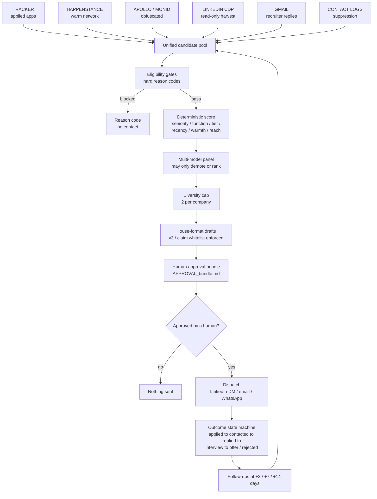

# ADR-002 — Outreach engine v2 architecture

*Status:* Accepted · *Date:* 2026-11-12 · *Supersedes:* nothing (adds to ADR-001)

## Context

The outreach lane had fragmented into 11+ ad-hoc scripts
(`runs/outreach/build_approval.py`, `build_approval_v4.py`, `build_next30.py`,
`build_table_v3.py`, `rank_targets_v2.py`, `rank_targets_v3.py`,
`harvest_fresh.py`, `harvest_people_v2..v5.py`, `outreach_refresh.py`,
`apollo_verify*.py`) with five overlapping candidate pools, no single source of
truth, messages regenerated from stale context, and no outcome loop.

Three concrete failure modes followed from that fragmentation:

1. **Claim drift.** Earlier packs contained `8x to $36M` — a claim the
   canonical profile marks as *verbal-only, never in writing*. A message
   generator that reads no whitelist will eventually ship it.
2. **Rule drift.** `banned_company_hit` existed in more than one file with
   different semantics, and short banned entries could match inside longer
   words.
3. **No feedback loop.** Nothing recorded that a DM went out, that it got a
   reply, or that a follow-up was due — so cadence was guesswork and
   duplicates were possible.

The tracker (`applied_companies_tracker.json`) is the only reliable record of
*what we applied for and when*. Every outreach target is a **person at a
company we applied to**, so application context must be joined by company —
never invented per adapter.

## Decision

Build ONE deterministic, rule-first, human-gated outreach engine in
`outreach_engine/` (Python 3 stdlib only, no new pip dependencies).

**The pipeline:**

**Principles**

- **Canonical data is read at runtime.** `pipeline_v2/canonical_profile.json`
  supplies identity, `claims_approved`, `claims_banned_written`,
  `companies_banned`, `do_not_approach`, `seniority.leadership_keywords`.
  Nothing is hardcoded. Because `paytm` is banned via `claims_banned_written`
  and not via `companies_banned`, the engine unions the two lists when
  building the banned-company set.
- **Hard gates return stable reason codes.** Eleven codes, in a fixed order:
  `window_expired`, `banned_company`, `do_not_approach`, `r39_manager`,
  `r40_analyst`, `already_contacted`, `apollo_obfuscated_unresolved`,
  `no_url_no_email`, `not_senior`, `off_function`, `ta_or_business_dual`.
  A candidate that fires any code is never contacted.
- **Banned-company matching is word-boundary aware.** Normalised equality →
  whole-token match → plain substring only for entries of 5+ characters. So
  `nit` never matches inside `unitedhealth`, while `paytm` matches `Paytm`.
- **The panel may only demote.** A multi-model panel (R57) can remove or
  reorder an eligible candidate; it can never bypass a hard gate and never
  add a candidate. It degrades to `RULES_ONLY` on timeout or CLI absence,
  and the degradation is logged.
- **Claim enforcement is fail-closed.** Every number in a message body must
  be traceable to `claims_approved`; anything else raises `ClaimViolation`
  and the draft is dropped. Banned written strings (`$5M to $36M`, `$8M MRR`,
  `Paytm`) plus the bare `8x` multiple are asserted absent.
- **The human gate is explicit.** The engine writes an approval bundle; only
  an approved decision file can turn into a dispatch. Dispatch is dry-run
  unless `--send` is passed.
- **No adapter may crash the pipeline.** Every source adapter returns
  `[]` plus a warning when its data or API is missing.
- **Outcomes are appended to JSONL** (`runs/outreach/engine_state/outcomes.jsonl`),
  consistent with ADR-001: JSONL is the source of truth, derived files are
  rebuilt.

## Alternatives considered

**Keep patching the ad-hoc scripts.** Rejected: five candidate pools and
eleven scripts is the root cause, not the symptom. Rules would continue to
diverge between scripts.

**Use a framework (LangGraph / a workflow engine).** Rejected: the brief
requires stdlib-only, and the pipeline is a linear stage sequence with one
branch (the human gate). A framework would add a dependency for no gain.

**Let an LLM rank everything.** Rejected: non-deterministic, unauditable,
and it cannot be reasoned about after the fact. The panel is explicitly a
*second opinion on top of* deterministic rules, never a replacement.

**Send without a human approval step.** Rejected: it is the failure mode
this rebuild exists to remove.

## Consequences

**Positive**

- One place to change a rule; one place to change a claim whitelist.
- Every blocked candidate carries a reason code, so "why was X not
  contacted?" is answerable from the artifact alone.
- The approval bundle is human-reviewable in one sitting, with the exact
  message that will be sent.
- Follow-ups become mechanical instead of remembered.

**Negative / costs**

- Two representations of the same people exist (the old packs and the new
  pool). The suppression node reads the old packs so that already-contacted
  people stay suppressed; the old packs are not deleted.
- The LinkedIn dispatch still depends on a live CDP browser and on
  LinkedIn's DOM. When the Send control does not render, the engine logs
  `typed_needs_manual_send` and leaves the message typed for the human —
  it never claims "sent" without an actual click.
- Live Apollo/LinkedIn/Gmail lanes are opt-in (`OE_APOLLO_LIVE=1`,
  `OE_LINKEDIN_LIVE=1`, `OE_GMAIL=1`) so the default run is offline and
  spends nothing.

**Neutral**

- The panel backend is pluggable; in this environment no panel CLI is
  reachable, so the engine runs `RULES_ONLY` and says so.
